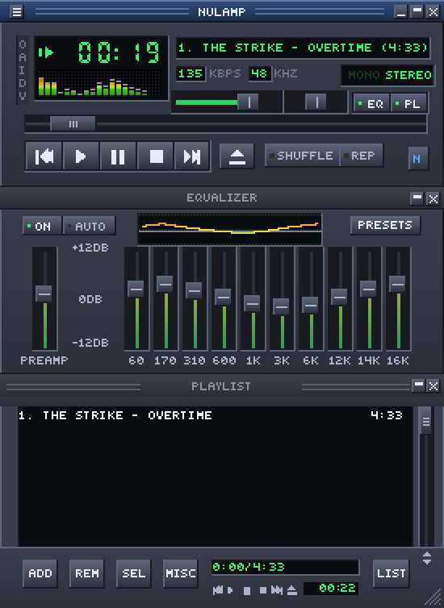
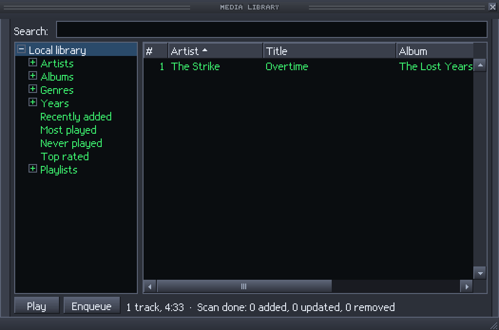

# nulamp

A cross-platform audio player that plays classic Winamp 2.x skins (`.wsz`).

nulamp is an independent, clean-room implementation written from the specification in
[`spec/`](spec/README.md). It is not affiliated with, and does not contain code or artwork from,
the original player. Its default skin is generated by [`tools/skingen`](tools/skingen).

<p>
  
  
</p>

## Features

- Classic skins: main window, equalizer and playlist editor, windowshade modes, double size,
  docking and snapping, `region.txt` window shapes, skinned cursors, the skin's bitmap fonts.
  Text is never antialiased.
- Playback: MP3, FLAC, Ogg Vorbis, Opus, WAV/AIFF, AAC/ALAC in MP4, MIDI (SoundFont), tracker
  modules (with libopenmpt), and HTTP/SHOUTcast/Icecast streams with in-band titles. Gapless
  playback, fades, ReplayGain, a 10-band equalizer and the classic spectrum analyzer and
  oscilloscope.
- Playlists: M3U/M3U8, PLS, XSPF, B4S, ASX, WPL, ZPL; title formatting; tag reading and writing;
  bookmarks; jump to file; queue.
- Media library: a local SQLite library with folder watching and search, behind a provider
  interface for other sources ([`docs/media-library.md`](docs/media-library.md)).
- Plugins: a C ABI for decoders, effects, visualizations and general modules
  ([`docs/plugins.md`](docs/plugins.md), [`include/nulamp_plugin.h`](include/nulamp_plugin.h)),
  plus built-in scripted effects ([`docs/scripted-dsp.md`](docs/scripted-dsp.md)).
- Remote control: the classic command-line switches against a running instance
  (`nulamp /?`), MPRIS on Linux, global hotkeys, tray icon.
- Imports the settings, EQ presets, bookmarks and playlist of an existing Winamp installation
  (`--import-winamp <dir>`, or automatically at the first start).

## Building

Rust 1.88 or newer, and on Linux the development packages for FreeType, fontconfig, X11/xcb,
xkbcommon, Wayland, ALSA and D-Bus. libopenmpt is optional: without it, tracker modules are
disabled. [`scripts/ci-deps.sh`](scripts/ci-deps.sh) lists the exact packages for Debian/Ubuntu
and macOS.

```bash
cargo build --release
./target/release/nulamp music/
```

On Linux nulamp runs through X11 (XWayland on Wayland sessions), because Wayland clients cannot
place their own windows, which docking needs. `NULAMP_WAYLAND=1` selects native Wayland.

Settings live in the platform config folder (`~/.config/nulamp` on Linux; `NULAMP_CONFIG_DIR`
overrides it). Skins go in its `skins` folder or can be dropped on a player window.

## Development

```bash
./scripts/fix.sh     # clippy --fix, then rustfmt
./scripts/check.sh   # fmt check, clippy -D warnings, all tests
```

Branches, the clean-room rule, commit style and the golden-image tests are described in
[`CONTRIBUTING.md`](CONTRIBUTING.md).

## Documentation

- [`spec/`](spec/README.md): the functional specification.
- [`docs/decisions.md`](docs/decisions.md): choices made where the specification is silent or
  deliberately changed.
- [`docs/media-library.md`](docs/media-library.md), [`docs/plugins.md`](docs/plugins.md),
  [`docs/scripted-dsp.md`](docs/scripted-dsp.md).

## Licence

MIT OR Apache-2.0, at your option: [`LICENSE-MIT`](LICENSE-MIT), [`LICENSE-APACHE`](LICENSE-APACHE).
